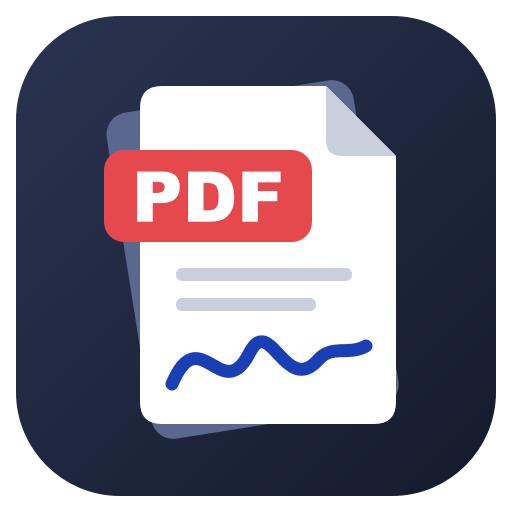

[中文](README.md)

# PDF Toolkit

A small PDF editor for Windows: split, merge, organise pages, add and edit text, mark up, sign, watermark,
password-protect and compress. Portable (nothing to install); everything is processed on your own PC and no file
is uploaded. The interface comes in Chinese and English; switch under Settings.



## Download

Get `PdfToolkit-v*-portable.zip` from [Releases](../../releases/latest), unzip it and double-click `PDF工具箱.exe`.
Needs Windows 10 / 11 (64-bit). Settings and saved signatures are kept in the `data` folder next to the exe.

## What it does

| | |
|---|---|
| **Merge** | Several PDFs / images into one PDF; optionally only some pages of each file (`1-3,5,8-`); bookmarks from the file names; images at their own size or on A4 |
| **Split** | By page ranges, every N pages, one file per page, by top-level bookmarks, or extract the selected pages into one file |
| **Pages** | Rotate, delete, drag to reorder, move to the front / end, insert pages from another file or blank pages (thumbnails can be multi-selected and right-clicked) |
| **Edit** | Add text (fonts are embedded), change or delete an existing line of text, insert images, highlight / underline / strikeout, pen / line / arrow / box / ellipse |
| **Erase / Redact** | Really removes the text and image pixels inside the box, instead of just covering them |
| **Signature** | Draw it (stroke width follows the speed), import a photo or scan with the paper background removed, or type a name; several can be saved, and a placed signature can be moved and resized |
| **Also** | Watermark (optionally tiled), page numbers, password protection (AES-256, with limits on printing / copying / changing), compress, export images, export text, print, undo / redo |

## Language

The first time, the program follows the language of Windows. Click **Settings** (top right) and choose
中文 or English: the whole interface switches at once, and the document you are editing keeps its undo steps.
File names the program makes up (such as `xx_p1-3.pdf` / `xx_第1-3页.pdf` when splitting) follow the language too.
For one run only, start it with `PDF工具箱.exe --lang en` (or `zh`).

## Run from source

```
python -m venv .venv
.venv\Scripts\pip install -r requirements.txt
.venv\Scripts\python main.py
```

Tests and build:

```
.venv\Scripts\python tests\t_i18n.py                # every text on screen exists in both languages
.venv\Scripts\python tests\t_core.py <scratch dir>
.venv\Scripts\python tests\t_gui.py  <scratch dir>  # leaves screenshots in the scratch dir
.venv\Scripts\python tests\t_lang.py <scratch dir>  # English interface and the language switch, with screenshots
.venv\Scripts\python build.py                       # dist\PDF工具箱.exe and the portable zip
```

Layout: `core/` holds the PDF operations without any UI (`pdfops.py`), the document model with undo
(`docmodel.py`) and the texts of both languages (`i18n.py`: the code is written in Chinese, the `EN` table holds
the English). `ui/` is the PySide6 interface. A new text on screen goes through `tr("中文")` and gets its English
in `EN`.

## Known limits

- "Edit text" changes one horizontal line at a time and does not wrap longer text; the fonts inside a PDF are
  usually incomplete, so the new text uses a system font.
- Text in a scan is a picture and cannot be edited: use Erase, then Add text.
- A signature is a picture placed on the page, not a certificate-based digital signature.
- A password-protected file asks for its password when opened; saving keeps the password, and Encrypt can
  remove or change it.

## Licence

AGPL-3.0 (see [LICENSE](LICENSE)). PDF handling uses [PyMuPDF](https://github.com/pymupdf/PyMuPDF) (AGPL-3.0);
the interface uses [PySide6 / Qt](https://www.qt.io/qt-for-python) (LGPL-3.0).
