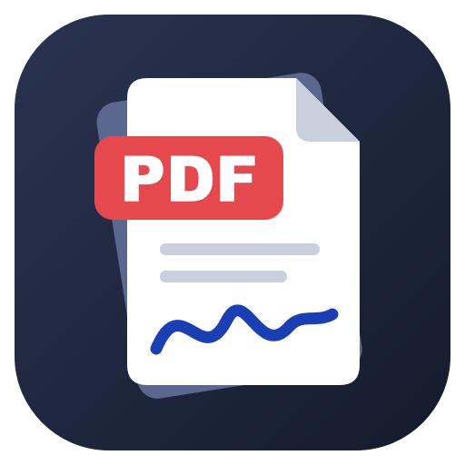

# PDF工具箱

Windows 上的 PDF 编辑小工具：拆分、合并、页面整理、加字改字、批注、签名、水印、加密、压缩。
绿色免安装，所有处理都在本机完成，文件不会上传。



## 下载

到 [Releases](../../releases/latest) 下载 `PdfToolkit-v*-portable.zip`，解压后双击 `PDF工具箱.exe`。
需要 Windows 10 / 11（64 位）。设置和保存的签名放在 exe 旁边的 `data` 文件夹。

## 功能

| | |
|---|---|
| **合并** | 多个 PDF / 图片合成一个 PDF；每个文件可只取部分页（`1-3,5,8-`）；按文件名生成书签；图片可按原尺寸或放到 A4 |
| **拆分** | 按页码范围、每 N 页、每页一个文件、按一级书签拆分，或把选中的页提取成一个文件 |
| **页面** | 旋转、删除、拖动排序、移到最前/最后、插入其他文件的页面或空白页（缩略图可多选、右键） |
| **编辑** | 加文字（中文字体内嵌）、修改/删除已有的一行文字、插入图片、高亮/下划线/删除线、画笔/直线/箭头/方框/圆圈 |
| **擦除 / 涂黑** | 真正删除框选区域里的文字和图片像素，而不只是盖住 |
| **签名** | 手写（笔锋粗细随速度变化）、从照片/扫描件导入并自动去掉纸张背景、输入姓名生成；可保存多个，放到页面后可拖动缩放 |
| **其他** | 水印（可平铺）、页码、密码保护（AES-256，可限制打印/复制/修改）、压缩、导出图片、导出文字、打印、撤销/重做 |

## 从源码运行

```
python -m venv .venv
.venv\Scripts\pip install -r requirements.txt
.venv\Scripts\python main.py
```

测试与打包：

```
.venv\Scripts\python tests\t_core.py <临时目录>
.venv\Scripts\python tests\t_gui.py  <临时目录>     # 会在临时目录里留下界面截图
.venv\Scripts\python build.py                       # dist\PDF工具箱.exe 和绿色版 zip
```

结构：`core/` 是不依赖界面的 PDF 操作（`pdfops.py`）和带撤销的文档模型（`docmodel.py`），`ui/` 是 PySide6 界面。

## 已知限制

- “改文字”只能改一行横排文字，改长了不会自动换行；原文件内嵌的字体通常不完整，新文字会换用系统字体。
- 扫描件里的字是图片，不能直接改：先“擦除”再“加文字”。
- 签名是把签名图片盖到页面上，不是带数字证书的电子签章。
- 打开有密码的文件需要输入密码；保存时保留原密码，可在“加密”里移除或修改。

## 许可

AGPL-3.0（见 [LICENSE](LICENSE)）。PDF 处理使用 [PyMuPDF](https://github.com/pymupdf/PyMuPDF)（AGPL-3.0），界面使用 [PySide6 / Qt](https://www.qt.io/qt-for-python)（LGPL-3.0）。
